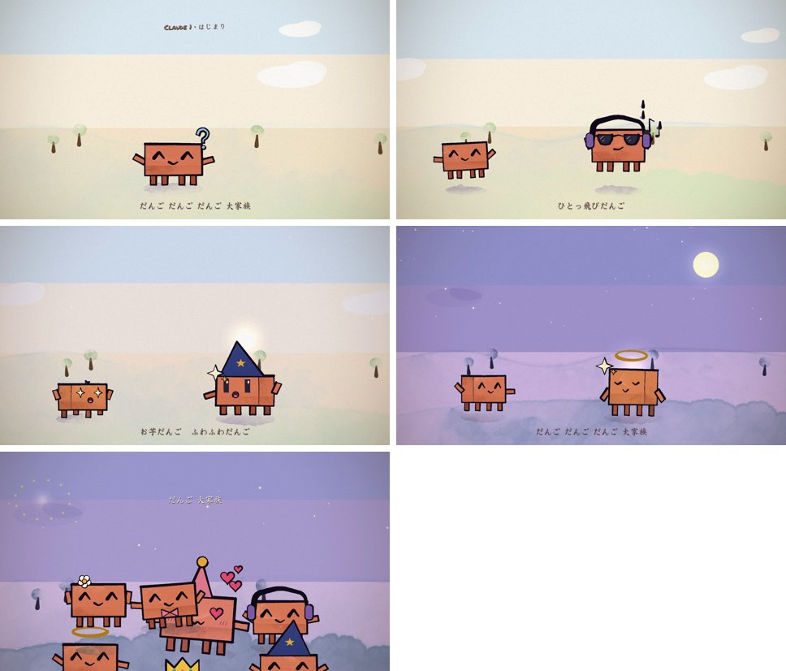

# 🎨 Clawd Animation Kit — 一句话做手绘MV（中文增强包）

> 让 Claude Code 用代码画出**手绘水彩风的动画短片**，配你喜欢的歌，45秒成片。
> 基于 [John Heibel 的 ClaudeAnimationBase](https://github.com/JohnHeibel/ClaudeAnimationBase)（MIT）中文增强：**日文/中文歌词轴、版本注释、烟花、场景丰富化**组件 + 完整中文教程 + 抖音爆款《团子大家族·Claude家族篇》全套源码案例。



**Clawd** 是 Claude Code 的吉祥物：一块陶土色的方脸小机器人。这个工具包让它走路、跳舞、施魔法、举重、打碟——31 种情绪、15 种帽子、5 个转身视角，全部手绘水彩笔触，每一帧都在"沸腾"。

---

## ✨ 它能做什么

| 你说 | 它做 |
|------|------|
| "做一个45秒的团子大家族MV，六代Claude每人展示一个技能" | 分镜 → 逐镜绘制 → 自检 → 渲染带音乐的MP4 |
| "让Clawd抓蝴蝶" | 15秒小动画 |
| "加上日文歌词和烟花" | 歌词轴组件 + 烟花组件自动上场 |

抖音上爆火的「Vibe知识大赏」类 Claude 动画短片，用的就是同一条技术路线。

## 📦 三分钟上手

```bash
# 0. 要求：Node.js 18+、Chrome、ffmpeg（加进 PATH）
git clone https://github.com/<你的用户名>/clawd-animation-kit.git
cd clawd-animation-kit
npm install

# 1. 把你的歌放进项目，比如 CLANNAD《だんご大家族》45秒剪辑
#    （请自备有版权的音乐，本仓库不附带）

# 2. 打开 src/scenes/tuanzi.js 看这个完整案例，
#    或直接让 Claude Code 干活：
#    「读 SKILL.md，然后照团子大家族的样子，做一个XX主题的45秒MV」
```

**一键渲染（含混音）：**

```bash
node render.mjs --clip --audio="你的歌.wav" --out=out/video.mp4
```

**渲染前先看关键帧（不浪费渲染时间）：**

```bash
node render.mjs --sheet=3,8.5,15,41 --cols=4 --w=420 --out=out/check/sheet.jpg
```

在 Chrome 里打开 `studio.html` 可以逐帧预览和调试。

## 🗂 目录导览

| 路径 | 内容 |
|------|------|
| `SKILL.md` | **Claude Code 技能文件**——复制到 `~/.claude/skills/clawd-animation/` 即可一句话出片 |
| `ANIMATION_GUIDE.md` | 引擎完整规则与API（上游文档，必读） |
| `STORYBOARD_TUANZI.md` | 《团子大家族》分镜范本（含 reads 时间轴方法论） |
| `src/scenes/tuanzi.js` | **完整成片源码**：七幕剧情+歌词轴+版本注+烟花 |
| `docs/components.md` | 中文增强组件API（歌词轴/版本注释/烟花/云树背景） |
| `docs/emotions.jpg` | Clawd 的 31 种情绪表 |
| `docs/views.jpg` | 5 视角、运动辅助线、帽子一览 |
| `README_UPSTREAM.md` | 上游引擎英文说明（保留署名） |

## 🧩 中文增强组件（本仓库新增）

上游引擎管画面，这些组件管"叙事层"，全部在 `src/scenes/tuanzi.js` 里可直接抄：

- **歌词轴 `LYRICS + lyric(t)`** —— 歌词随唱段淡入淡出，自动支持手绘字体
- **版本注释 `version()`** —— 角色登场时顶部队列手绘小注
- **烟花 `firework()`** —— 升空弧线 + 放射绽放 + 光晕余晖，卡点副歌
- **场景丰富化 `ground()`** —— 飘云、摇曳小树、远山、星月，昼夜渐变一键切换

详见 [docs/components.md](docs/components.md)。

## ⚠️ 渲染须知

- 无独立GPU的机器：水彩填充较慢（约0.5–2秒/帧），45秒片约15分钟；可让 Claude 把水彩填充换成平涂提速
- `--encode`/`--clip` 依赖 PATH 里的 ffmpeg
- Chrome 不在默认位置时：`--chrome="C:\path\to\chrome.exe"`

## 📄 许可

MIT。引擎与角色设计来自 [JohnHeibel/ClaudeAnimationBase](https://github.com/JohnHeibel/ClaudeAnimationBase)，本仓库在其基础上做中文教程与叙事层组件增强，同样以 MIT 开源。

> 音乐版权请自理：请使用你有权使用的音乐（自作曲/已授权曲目/站内曲库）。

---

*如果这个包帮你做出了第一条爆款，欢迎回来点个 Star ⭐*
